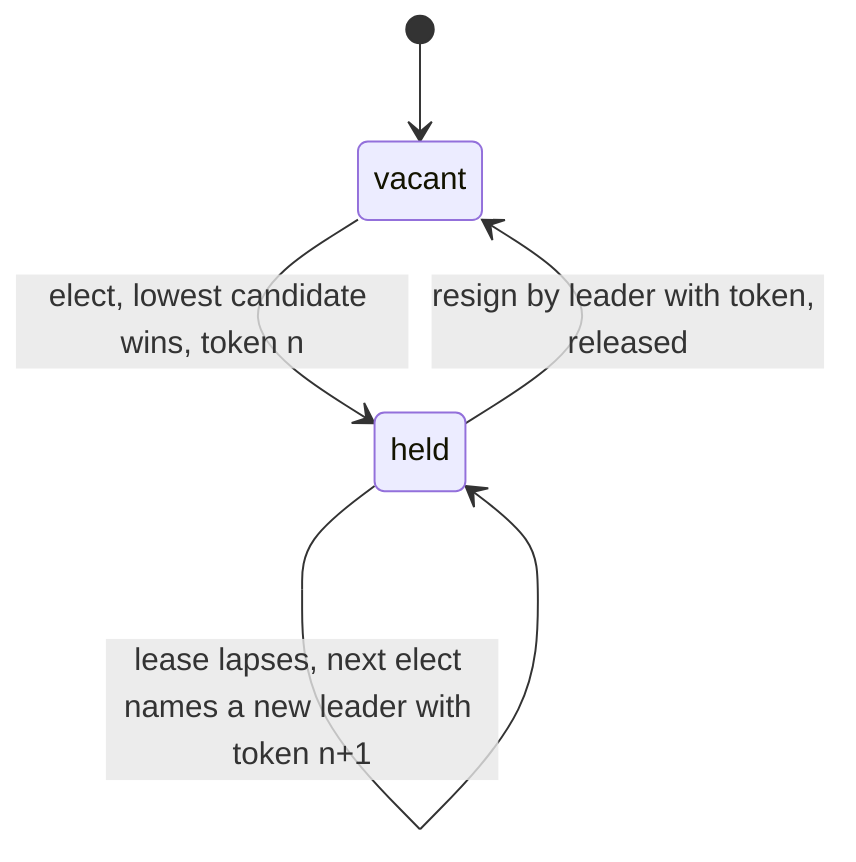

# ElectionMachines

> One captain at a time, and silence from the bridge is not a vacancy. 📡

Leader election for Ruby, backed by a lease. You hand in the list of workers that showed up, it names one of them captain and gives them a lease with a token. The captain keeps the chair by heartbeating before the lease runs out. Everyone else is told who the incumbent is. Nobody gets the chair by shouting louder, and a captain who stops answering loses it only when the clock says so.

## Quick Start

```bash
gem 'election_machines'
```

```ruby
election = ElectionMachines::Election.new

# Three workers report in. The lowest id takes the chair.
status, leader, token, expires_at = election.elect([9, 2, 5], clock.now, 30.0)
# => ["elected", 2, 1, 30.0]

# The leader keeps the chair by heartbeating with its token.
election.heartbeat(2, token, clock.now, 30.0)
# => ["renewed", 2, 1, ...]

# Anyone else asking while the lease is live just learns who's in charge.
election.elect([5], clock.now, 30.0)
# => ["incumbent", 2, 1, ...]
```

Every call returns the same four-element shape: a status string, then the leader, token, and expiry, or three nils when there's nothing to report.

## A Message to the Resistance

So you have three schedulers and only one of them should be ticking the cron table. You picked "lowest hostname wins" and it worked for a year. Then the lowest hostname hit a network partition for ninety seconds. The other two couldn't reach it, decided it was dead, and the second-lowest took over. The first one never knew. For ninety seconds you had two captains, and your billing job ran twice.

"It stopped answering" and "it's gone" are different facts. The first is what you observed. The second is what you assumed. The gap between them is where the double-charge lives.

An election built on a lease closes that gap. The leader holds the chair until a stated time, not until someone stops hearing from it. If it's quiet but the lease is live, the answer to "can I take over?" is still no. When the lease lapses, the next election hands out a new token, and the old captain's token stops working everywhere it's checked.

## Chapter 1: Stardate 2025.186, the AMS LeLann

> **AMS LeLann**, NCC-4206, *LeLann*-class command relay.
> An unanswered hail is not permission to appoint a second captain.

The relay doesn't fly the ship. It keeps the roster and the chair. When a crew reports for duty, the relay names the lowest-numbered one captain and stamps a lease. Captains renew by hailing with their token. A crew that hails about an empty chair gets it. A crew that hails about an occupied one is told who sits there, and nothing else.

Somewhere on a lower deck, a lieutenant proposes:

```ruby
def am_i_leader?
  peers.none? { |peer| peer.alive? && peer.id < my_id }
end
```

"That," says the relay officer, "is how a ship ends up with two captains during a comms blackout."

## The Flight Plan



And the ninety seconds the cron leader went quiet:


## How the Relay Works

### Elect

Pass the ids of the workers that are present, the current time, and how long the lease should last. The lowest id wins. The token starts at 1 and only ever goes up.

```ruby
election = ElectionMachines::Election.new

election.elect([9, 2, 5], 0, 10)   # => ["elected", 2, 1, 10.0]
election.lease                     # => [2, 1, 10.0]
```

Ask again while that lease is live and you get the incumbent, even if you offer a lower id. Sitting captains aren't unseated by a late arrival.

```ruby
election.elect([1], 1, 10)         # => ["incumbent", 2, 1, 10.0]
```

An empty roster is `no_candidates`.

### Heartbeat

The leader renews by presenting its id and token. The new expiry is counted from `now`.

```ruby
election = ElectionMachines::Election.new
election.elect([2], 0, 10)

election.heartbeat(2, 1, 3, 10)    # => ["renewed", 2, 1, 13.0]
election.heartbeat(1, 1, 4, 10)    # => ["WrongOwner", nil, nil, nil]
```

A heartbeat from anyone but the leader is refused and changes nothing.

### Resign

A leader steps down by presenting its token. The chair is vacant immediately, and the next election fills it.

```ruby
election.resign(2, 1, 5)           # => ["released", nil, nil, nil]
election.lease                     # => nil
election.elect([7, 3], 6, 10)      # => ["elected", 3, 2, 16.0]
```

Token 2. The old token is dead from here on.

### When the leader goes quiet

Nothing happens at the moment of expiry. The chair is only re-filled when someone asks. Until then, `lease` still describes the lapsed lease, so you can see who was last in charge.

```ruby
election = ElectionMachines::Election.new
election.elect([2], 0, 10)

election.heartbeat(2, 1, 11, 10)   # => ["Expired", nil, nil, nil]
election.lease                     # => [2, 1, 10.0]

election.elect([5], 12, 10)        # => ["elected", 5, 2, 22.0]
election.heartbeat(2, 1, 13, 10)   # => ["WrongOwner", nil, nil, nil]
```

The old leader's late heartbeat is rejected with `WrongOwner`. Its token is also stale, and `StaleToken` is what you'd see if it had the right id and the wrong token.

### Time only moves forward

You supply `now`. The election remembers the latest it has seen and refuses to go backwards.

```ruby
election = ElectionMachines::Election.new
election.elect([2], 5, 10)
election.elect([2], 0, 10)         # => ["ClockRegressed", nil, nil, nil]
```

Feed it a monotonic clock. Not the wall clock.

## Checkpoints

An election can hand you a `Checkpoint` and roll back to it, but only itself, and only to the most recent one.

```ruby
election = ElectionMachines::Election.new
election.elect([1], 0, 10)
saved = election.checkpoint

election.heartbeat(1, 1, 1, 10)    # => ["renewed", 1, 1, 11.0]
election.restore!(saved)           # => ArgumentError, a transition happened since
```

Any successful transition, or any successful restore, invalidates every checkpoint taken before it. That rules out rewinding past a decision someone has already acted on. A checkpoint from one election can't be fed to another. This is for testing and in-process simulation, not for surviving a restart.

## The Rules of the Relay

- **Ids and tokens are Integers** in `0..2**64-1`. Up to 64 candidates per election. Floats and strings raise `TypeError`, out of range raises `RangeError`, a 65th candidate raises `ArgumentError`.
- **Times are seconds** as Integer or Float, from a monotonic origin you choose. `ttl` must be positive. Negative, infinite, NaN, or absurdly large values raise `ArgumentError`.
- **Rejections don't raise.** `WrongOwner`, `StaleToken`, `Expired`, `ClockRegressed`, and `no_candidates` all come back as a status with three nils. Only malformed input raises.
- **Bad input never half-applies.** Arguments are checked before anything changes.
- **Frozen means frozen.** `freeze` the election and `elect`, `heartbeat`, `resign`, and `restore!` raise `FrozenError`. `lease` still reads.

## What You Think You're Doing vs Reality

### You Think: "If I can't reach the leader, the leader is down."
### Reality: You can't reach the leader. That's all you know.

A partition looks identical to a crash from the outside. If your election promotes on silence, every network hiccup is a coup. If it promotes on lease expiry, the worst case is a leaderless gap of one ttl, which is boring, and boring is what you want from the thing that decides who runs billing.

## What's Yours

The election decides. It doesn't talk to the network, run timers, or store anything across a restart. Run it in one place, write its decisions down before anyone acts on them, and make the thing the leader controls check the token before every action. A token the resource has already seen beaten is a captain who has already been replaced.

## License

MIT License. See [LICENSE.txt](LICENSE.txt) for details.

**Remember: Scheduler A was never dead. It just couldn't hear you say it was.**
