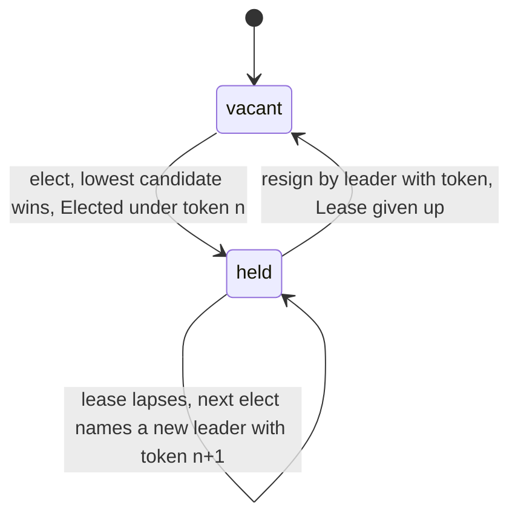
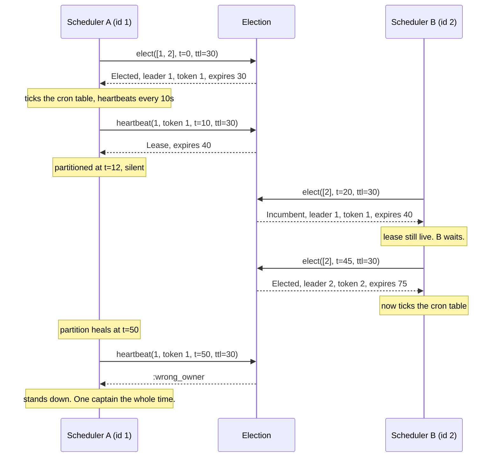

# ElectionMachines

> One captain at a time, and silence from the bridge is not a vacancy. 📡

Leader election for Ruby, backed by a lease. You hand in the list of workers that showed up, it names one of them captain and gives them a lease with a token. The captain keeps the chair by heartbeating before the lease runs out. Everyone else is told who the incumbent is. Nobody gets the chair by shouting louder, and a captain who stops answering loses it only when the clock says so.

## Quick Start

```bash
gem 'election_machines'
```

```ruby
SECOND = 1_000_000_000 # every instant and span is Integer nanoseconds
now = -> { Process.clock_gettime(Process::CLOCK_MONOTONIC, :nanosecond) }

election = ElectionMachines::Election.new

# Three workers report in. The lowest id takes the chair.
elected = election.elect([9, 2, 5], now.call, 30 * SECOND)
# => Elected(lease: Lease(owner: 2, token: FencingToken(raw: 1), expires_at: ...))
token = elected.lease.token

# The leader keeps the chair by heartbeating with its token.
election.heartbeat(2, token, now.call, 30 * SECOND)
# => Lease(owner: 2, token: FencingToken(raw: 1), expires_at: ...)

# Anyone else asking while the lease is live just learns who's in charge.
election.elect([5], now.call, 30 * SECOND)
# => Incumbent(lease: Lease(owner: 2, ...))

# A call that isn't honoured answers a Symbol and changes nothing.
election.heartbeat(5, token, now.call, 30 * SECOND)
# => :wrong_owner
```

The Ruby API is the core's, name for name: `ElectionMachines::Election` is the core's `Election`, every `Data` value has the fields of the core type it mirrors, and arguments come in the core's order. An honoured call answers a value (`Elected`, `Incumbent`, `Lease`). A refused one answers a Symbol, never raises, and leaves the election exactly as it was.

## A Message to the Resistance

So you have three schedulers and only one of them should be ticking the cron table. You picked "lowest hostname wins" and it worked for a year. Then the lowest hostname hit a network partition for ninety seconds. The other two couldn't reach it, decided it was dead, and the second-lowest took over. The first one never knew. For ninety seconds you had two captains, and your billing job ran twice.

"It stopped answering" and "it's gone" are different facts. The first is what you observed. The second is what you assumed. The gap between them is where the double-charge lives.

An election built on a lease closes that gap. The leader holds the chair until a stated time, not until someone stops hearing from it. If it's quiet but the lease is live, the answer to "can I take over?" is still no. When the lease lapses, the next election hands out a new token, and the old captain's token stops working everywhere it's checked.

## Chapter 1: Stardate 2025.186, the AMS LeLann

> **AMS LeLann**, NCC-4206, *LeLann*-class command relay.
> An unanswered hail is not permission to appoint a second captain.

The relay doesn't fly the ship. It keeps the roster and the chair. When a crew reports for duty, the relay names the lowest-numbered one captain and stamps a lease. Captains renew by hailing with their token. A crew that hails about an empty chair gets it. A crew that hails about an occupied one is told who sits there, and nothing else.

Somewhere on a lower deck, a lieutenant proposes:

```ruby
def am_i_leader?
  peers.none? { |peer| peer.alive? && peer.id < my_id }
end
```

"That," says the relay officer, "is how a ship ends up with two captains during a comms blackout."

## The Flight Plan



And the ninety seconds the cron leader went quiet:



## How the Relay Works

The examples count in seconds to stay readable: `s = 1_000_000_000`, so `10 * s` is ten seconds of Integer nanoseconds.

### Elect

Pass the ids of the workers that are present, the current time, and how long the lease should last. The lowest id wins. The list can be any length. The token's sequence starts at 1 and only ever goes up.

```ruby
election = ElectionMachines::Election.new

elected = election.elect([9, 2, 5], 0, 10 * s)
elected.lease            # => Lease(owner: 2, token: FencingToken(raw: 1), expires_at: 10 * s)
elected.incumbent?       # => false
election.lease           # => the same Lease
```

Ask again while that lease is live and you get the incumbent, even if you offer a lower id. Sitting captains aren't unseated by a late arrival. `Incumbent` is an honoured answer, not a refusal: there is a leader, here is its lease, and nothing changed.

```ruby
election.elect([1], 1 * s, 10 * s)   # => Incumbent(lease: Lease(owner: 2, ...))
```

An empty roster is the refusal `:no_candidates`, whatever the clock and whoever sits in the chair: nobody was nominated. To learn who leads without nominating anyone, read `election.lease`.

### Heartbeat

The leader renews by presenting its id and token. The new expiry is counted from `now`, and it never moves backwards: a repeated or reordered heartbeat is honoured and loses no time.

```ruby
election = ElectionMachines::Election.new
token = election.elect([2], 0, 10 * s).lease.token

election.heartbeat(2, token, 3 * s, 10 * s)   # => Lease(owner: 2, token: ..., expires_at: 13 * s)
election.heartbeat(1, token, 4 * s, 10 * s)   # => :wrong_owner
```

A heartbeat from anyone but the leader is refused and changes nothing.

### Resign

A leader steps down by presenting its token, and is answered the lease it gave up. The chair is vacant immediately, and the next election fills it.

```ruby
election.resign(2, token, 5 * s)        # => Lease(owner: 2, ...), the one given up
election.lease                          # => nil
election.resign(2, token, 5 * s)        # => :no_lease, the election keeps no record of who resigned
election.elect([7, 3], 6 * s, 10 * s)   # => Elected(lease: Lease(owner: 3, token: FencingToken(raw: 2), ...))
```

Token 2. The old token is dead from here on.

### When the leader goes quiet

Nothing happens at the moment of expiry. The chair is only re-filled when someone asks. Until then, `lease` still describes the lapsed lease, so you can see who was last in charge.

```ruby
election = ElectionMachines::Election.new
old = election.elect([2], 0, 10 * s).lease.token

election.heartbeat(2, old, 11 * s, 10 * s)   # => :expired
election.lease                               # => Lease(owner: 2, ..., expires_at: 10 * s)

election.elect([5], 12 * s, 10 * s)          # => Elected(lease: Lease(owner: 5, token: FencingToken(raw: 2), ...))
election.heartbeat(2, old, 13 * s, 10 * s)   # => :wrong_owner
```

The old leader's late heartbeat is refused with `:wrong_owner`. Its token is also stale, and `:stale_token` is what you'd see if it had the right id and the wrong token.

### Time only moves forward

You supply `now`. The election remembers the latest one it honoured and refuses to go backwards. A refused call never moves that watermark.

```ruby
election = ElectionMachines::Election.new
election.elect([2], 5 * s, 10 * s)
election.elect([2], 0, 10 * s)         # => :clock_regressed
```

Feed it a monotonic clock, `Process.clock_gettime(Process::CLOCK_MONOTONIC, :nanosecond)`. Not the wall clock. If your clock can step back and you would rather not refuse, `election.with_clock_policy(:clamp)` evaluates an earlier `now` at the watermark instead, so a backwards step can neither revive a lease nor shorten one.

### Tokens and scopes

A `FencingToken` is plain data: `raw` is the election's scope in the top 16 bits above a sequence number counted from 1. `ElectionMachines::Election.new` is scope zero, so its tokens read 1, 2, 3. Two elections in one scope issue the same tokens, so give every election whose tokens could meet its own scope:

```ruby
billing = ElectionMachines::Election.with_scope(1)
reports = ElectionMachines::Election.with_scope(2)

token = billing.elect([4], 0, 10 * s).lease.token
token.scope                                  # => 1
reports.heartbeat(4, token, 1 * s, 10 * s)   # => :unknown, not a token of this election
```

Tokens of one scope are ordered, tokens of two scopes are not, so there is no `<`. Compare with `token.order(other)` (`-1`, `0`, `1`, or `nil` across scopes) and `token.newer_than?(other)`.

`FencingToken`, `Lease` and `Checkpoint` are the lease core's types, which the election core re-exports. Wherever a method takes one it reads it by its readers (`raw`; `owner`, `token`, `expires_at`; `scope`, `issued`, `lease`, `observed`), so the `lease_machines` gem's values of the same names fit as they are. This gem does not depend on that one. A bare Integer is not a token: it raises `TypeError`. What it keeps is always its own: a `Lease` built with the lease gem's token, a `Checkpoint`, `Elected` or `Incumbent` built with the lease gem's lease, holds this gem's `FencingToken` and `Lease`, so it is `==` to what the election answers.

## Checkpoints

A fresh election counts from 1 again, so it would hand out tokens the old one already issued. To survive a restart, write the checkpoint down before anyone acts on the decision that produced it, and build the next election from it.

```ruby
election = ElectionMachines::Election.with_scope(7)
election.elect([1], 0, 10 * s)
saved = election.checkpoint
# => Checkpoint(scope: 7, issued: 1, lease: Lease(owner: 1, ...), observed: 0)

# The process dies. Rebuild from the four stored fields.
saved = ElectionMachines::Checkpoint.from_parts(scope, issued, lease, observed)
election = ElectionMachines::Election.restored(7, saved, :reject)
election.elect([2], 10 * s, 10 * s).lease.token   # => FencingToken(raw: (7 << 48) | 2), never 1 again
```

`restored(scope, checkpoint, clock_policy)` takes the scope and the clock policy explicitly: the scope is yours to pass, never read out of the checkpoint, and a checkpoint of another scope raises `RangeError`. A `Checkpoint` is plain data, so any election of that scope can be restored from it, and a refused call leaves an earlier checkpoint as current as it was. `Checkpoint.from_parts` raises `RangeError` when the fields contradict each other: a live lease must carry token number `issued` of `scope`.

One thing no value can check: restoring an older checkpoint than the newest one you committed reissues tokens. Persist first, expose second.

## Every answer

| Method | Honoured | Refused (changes nothing) | Records the clock |
| --- | --- | --- | --- |
| `elect(candidates, now, ttl)` | `Elected(lease)` (new leader, new token), `Incumbent(lease)` (live leader stays, nothing changed) | `:no_candidates`, `:clock_regressed`, `:invalid_ttl`, `:exhausted` | `Elected`: yes, the new lease's expiry depends on `now`. `Incumbent`: no, nothing changes |
| `heartbeat(owner, token, now, ttl)` | `Lease` under the same token; a repeat is honoured | `:unknown`, `:clock_regressed`, `:no_lease`, `:wrong_owner`, `:stale_token`, `:expired`, `:invalid_ttl` | yes: honoured only while unexpired at `now`, a repeat included |
| `resign(owner, token, now)` | `Lease`, the one given up | `:unknown`, `:clock_regressed`, `:no_lease` (a repeat included), `:wrong_owner`, `:stale_token`, `:expired` | yes: honoured only while unexpired at `now` |
| `lease` | `Lease` or `nil` | | |
| `checkpoint` | `Checkpoint` | | |
| `scope`, `issued`, `clock_policy` | Integer, Integer, `:reject` or `:clamp` | | |
| `with_clock_policy(clock_policy)` | the election itself | | |
| `Election.new`, `Election.with_scope(scope)` | `Election` | | |
| `Election.restored(scope, checkpoint, clock_policy)` | `Election` | raises `RangeError` for a checkpoint of another scope | |

Under `:clamp` the instant recorded is the one the call was evaluated at, so the observed clock stays where it was.

`ElectionMachines::REFUSALS` lists exactly the nine symbols above, the ones an election can answer. `:no_candidates` is the election's own. The other eight are the lease core's refusals, which the election core carries whole (`Refusal::Lease(..)`) and answers under the lease core's own symbol, so `:wrong_owner` here is the `lease_machines` gem's `:wrong_owner`. The lease core's `:occupied` and `:held` never come back: a live leader is the honoured `Incumbent`. Its `:fenced` and `:out_of_phase` belong to the lease holder, which an election has none of.

## The Rules of the Relay

- **Owners are Integers** in `0..2**64-1`, in a list of any length. Floats, strings and nil raise `TypeError`, out of range raises `RangeError`.
- **Times are Integer nanoseconds**, from a monotonic origin you choose, for instants (`now`, `expires_at`, `observed`) and spans (`ttl`) alike. A Float raises `TypeError`, a negative or unrepresentable value raises `RangeError`. A zero `ttl`, or one that overflows, is the refusal `:invalid_ttl`.
- **Refusals don't raise.** Every one is a Symbol: `:no_candidates` for the core's `Refusal::NoCandidates`, and for `Refusal::Lease(reason)` the lease core's symbol for `reason`. There is no catch-all. Only malformed input raises: `TypeError` for the wrong type, `RangeError` for a value the core does not accept (a clock policy other than `:reject` or `:clamp` included). Nothing raises `ArgumentError` except Ruby itself, for the wrong number of arguments.
- **Values are valid or do not exist.** `FencingToken.new`, `Lease.new`, `Checkpoint.new`, `Elected.new` and `Incumbent.new` are checked by the core whoever calls them: `Lease.new('x', token, 0)` raises `TypeError`, `Lease.new(1, token, -1)` raises `RangeError`.
- **The binding never loses work.** Every argument is read and checked before the election is asked anything. Building the answer runs Ruby (`Elected.new`, `Incumbent.new`, `Lease.new`, `FencingToken.new`), so the election decides on a copy, the answer is built, and the copy is kept only if the election is still unfrozen (`FrozenError` otherwise) and unchanged (`RuntimeError` otherwise: something re-entered it while the answer was built). A call that raised changed nothing.
- **The binding is the authority on values.** `FencingToken`, `Lease`, `Checkpoint`, `Elected` and `Incumbent` are sealed (no `allocate`, no subclass), but Ruby binds a subclass constant before `inherited` raises, `Data#initialize` can be bound directly and `Marshal.load` skips `initialize`. So the native side reads one of this gem's values only when it is exactly that class (a subclass raises `TypeError`, whatever it holds) and checks every field again as the core's constructor does: a forged value raises `TypeError` or `RangeError` and never reaches the election.
- **A refusal changes nothing.** Not the lease, not the token count, not the observed clock, not the checkpoint you saved a moment ago.
- **Honoured repeats.** `Incumbent` and a repeated `heartbeat` are honoured. A repeated `resign` is `:no_lease`, because the election cannot prove who resigned.
- **Scopes are yours.** `with_scope(scope)` takes an Integer in `0..65_535`; a token of another scope is `:unknown` before anything is looked up.
- **Frozen means frozen.** `freeze` the election and `elect`, `heartbeat`, `resign`, and `with_clock_policy` raise `FrozenError`. The readers still read.

## What You Think You're Doing vs Reality

### You Think: "If I can't reach the leader, the leader is down."
### Reality: You can't reach the leader. That's all you know.

A partition looks identical to a crash from the outside. If your election promotes on silence, every network hiccup is a coup. If it promotes on lease expiry, the worst case is a leaderless gap of one ttl, which is boring, and boring is what you want from the thing that decides who runs billing.

## What's Yours

The election decides. It doesn't talk to the network, run timers, or store anything: surviving a restart is `checkpoint` plus your storage. Run it in one place, write its decisions down before anyone acts on them, and make the thing the leader controls check the token before every action. A token the resource has already seen beaten is a captain who has already been replaced.

## License

MIT License. See [LICENSE.txt](LICENSE.txt) for details.

**Remember: Scheduler A was never dead. It just couldn't hear you say it was.**
